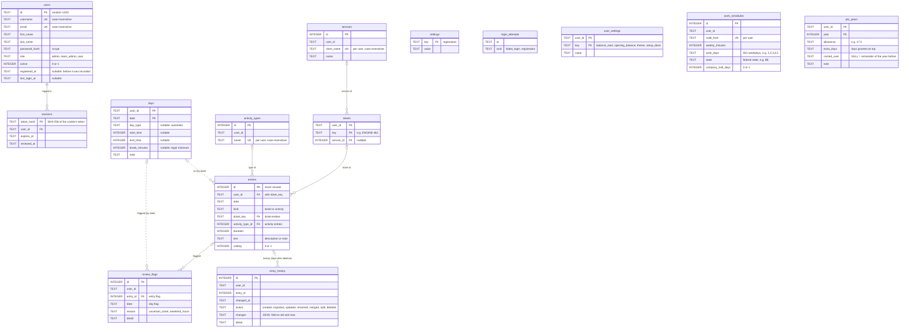

# work-tracker

Simple tracker for daily tasks: working hours, overtime balance, PTO and task entries for the
monthly work report. A Falcon REST API with a small browser frontend, backed by SQLite, run locally.

The project was partially implemented using claude.ai.

> Calculation rules, storage, spreadsheet import, REST API and frontend are done; later ideas are listed in
> `docs/TASKS.md`.

## Requirements

- Python 3.15
- [Pipenv](https://pipenv.pypa.io/)
- Node.js 26.13 (pinned in `.node-version`, e.g. via [fnm](https://github.com/Schniz/fnm)) for building the frontend

## Setup

```shell
pipenv install --dev
fnm use          # Node version from .node-version
npm install
npm run build    # compile the frontend: src/templates/ts → src/templates/static/js
```

The compiled JavaScript is not committed; build it after checking out or changing TypeScript (`npm run watch` rebuilds
on every change).

## Start from zero

Without a spreadsheet, e.g. when starting a new job: start the app on a new database file, and open
http://127.0.0.1:8000/.

```shell
export WORK_TRACKER_DB=work_tracker.db  # a file that does not exist yet
pipenv run python -m src
```

A new database starts clean, and every page forwards to `/setup` until it is set up. Its five steps ask for the first
day and an opening balance, the work schedule (hours per week, work days, federal state, company half days), the PTO
days per year and of the first year (a pro-rata number is proposed), and the services; "Start" saves everything and
opens the dashboard. Afterwards, everything can be changed on `/settings`. From the first day on, each work day counts
its full target as missing until its times are entered (today included).

## Import the spreadsheet

One CSV export per year; the database is `$WORK_TRACKER_DB`, or `work_tracker.db` in the working directory.

```shell
pipenv run python -m src.modules.importer "examples/Time_tracking_DK - 2024_Data.csv"
pipenv run python -m src.modules.importer "examples/Time_tracking_DK - 2024_Data.csv" --replace  # import a year again
```

A year is imported in one transaction: on any error nothing is written. `--replace` deletes the year's days,
entries, history and flags first; tickets keep their assigned services. The data goes to the only user (or, without
users, to the first one created later); with several users, `--user LOGIN` (username or e-mail address) names one.
After the import, a reconciliation compares every day up to today with the sheet and shows the overtime
balance and the year's PTO account.

## Run the app

```shell
pipenv run python -m src                       # http://127.0.0.1:8000/
pipenv run gunicorn 'src.app:create_app()' --reload  # alternative with auto-reload
```

Open http://127.0.0.1:8000/ for the frontend (build it first with `npm run build`): the dashboard with the key
figures (balance, PTO left, this week, open review items), the overtime balance over time (month, year, 12 months,
all), the days off coming up and this year's figures. `/week` shows the current week,
other weeks via `/week?week=2026-W44` (former `/?week=…` links forward there); days and entries are edited in place
(`&edit=2025-12-06` opens a day's form,
`&entry=129` an entry's form; each entry shows its change history). "Book days off" sets PTO, sick, unpaid leave or
overtime off on the work days of a range, with a preview and a popup for days that already hold times or entries. `/month` shows the month report with the work report
(coding hours by service and ticket), `/year` the year report (totals, PTO account, balance month by month); `/review`
lists what needs attention after
the import: guessed tickets (confirm, rename or split), entries without duration or ticket, flagged days, and tickets
without service (assign one to several at once). `/setup` sets up a new database or a new user's data (see "Start from zero"); `/admin` and `/register`: see "Login". `/settings` holds the overtime balance (start date, opening
balance), the work schedules, the PTO days per year, and
the services and activity types (add, edit, delete; an activity type used by entries cannot be deleted; `/lists`
forwards there), and the color theme (System, Light, Dark). All pages meet WCAG 2.2 AA in both
themes (checked with axe-core); Escape closes inline forms. `/components` is a
gallery of the UI components, each with its use and the HTML to copy. The database (`$WORK_TRACKER_DB` or
`work_tracker.db`) is migrated on start. API documentation:
`/apidoc/swagger`, `/apidoc/redoc` or `/apidoc/scalar`; the OpenAPI spec is at `/apidoc/openapi.json`.
These documentation routes are listed in the spec as well, under the Maintenance tag.
`$WORK_TRACKER_HOST` and `$WORK_TRACKER_PORT` change the address of the development server.

## Login

Every page and the API need a login; `/login`, `/register`, `/health`, the API docs and the static files stay open. A new database
creates the first user in the setup, an existing one asks for it once on the next visit. Log in with the username or
the e-mail address; a login stays valid for 24 hours since the last activity, "Log out" ends it, and the settings page
changes the profile and the password. Each user has their own data (days, entries, tickets, services, activity
types, schedules, PTO years, settings); nobody sees another user's. The first user is admin and takes over the data
of a database in use; a new user starts with the four default activity types and goes through the setup.

Admins see an "Admin" link to `/admin`: switching registration on or off (off by default) and the users with role,
status, registration and last login, but none of their time data. They make users admins or users again, deactivate
them (logged out at once, no login, data kept) and reactivate them; nobody demotes or deactivates themselves. While
registration is on, the login page links to `/register`, where new users create their account, are logged in and go
through the setup. Failed logins and registrations share a pause: after 5 within a minute, both wait a minute.
A forgotten password is reset on the computer running the app:

```shell
pipenv run python -m src.modules.auth set-password klara  # username or e-mail address; asks for the new password
```

For local development, the login can be switched off: `WORK_TRACKER_AUTH=off pipenv run python -m src`.

## Tests and code quality

```shell
pipenv run pytest
pipenv run flake8 --count --exit-zero --radon-max-cc 6 --radon-no-assert --max-line-length=127 \
  --statistics --exclude=.idea,.venv,test,.terraform --extend-ignore=E203,W503,ANN101,ANN102
```

```shell
npm test           # frontend tests (Node runs the TypeScript tests directly)
```

## API types for the frontend

The TypeScript types of the API are generated from its OpenAPI spec. After changing the API, run

```shell
npm run api-types  # writes src/templates/openapi.json, generates src/templates/ts/api-types.ts
```

and commit both files; a test fails while `openapi.json` is outdated. The generator (`openapi-typescript`)
runs through `npx` with its own TypeScript 5, as it does not support the project's TypeScript 7 yet.

## Project layout

| Path                   | Contents                                                                                                                                                                                                                                                                                                                                                                                                                      |
|------------------------|-------------------------------------------------------------------------------------------------------------------------------------------------------------------------------------------------------------------------------------------------------------------------------------------------------------------------------------------------------------------------------------------------------------------------------|
| `src/app.py`           | WSGI app: routes, storage errors as 404 / 409, API docs                                                                                                                                                                                                                                                                                                                                                                       |
| `src/__main__.py`      | Development server (`python -m src`)                                                                                                                                                                                                                                                                                                                                                                                          |
| `src/lib`              | Calculation rules: durations, breaks, holidays, targets, overtime, PTO                                                                                                                                                                                                                                                                                                                                                        |
| `src/models`           | Pydantic models                                                                                                                                                                                                                                                                                                                                                                                                               |
| `src/modules`          | Features: auth (login, registration), admin, dashboard, storage, import, days, entries, tickets, catalog, settings, setup, work schedules, PTO years, reports, review, pages                                                                                                                                                                                                                                                  |
| `src/utils`            | Shared helpers; `spec`: OpenAPI docs and validation (spectree); `api`: shared API types; `openapi`: spec file for the frontend types                                                                                                                                                                                                                                                                                          |
| `src/defaultresources` | Default resource at `/health` (plain-text status)                                                                                                                                                                                                                                                                                                                                                                             |
| `src/templates`        | Frontend: `frame.html` (shared page frame), `pages/` (page content), `static/` (served at `/static`: `css/main.css` with the UI style variables (light and dark), Inter font with its OFL license in `fonts/`), TypeScript in `ts/` (`main.ts` loads the page code, e.g. `week.ts`; `api.ts`: typed API client, `api-types.ts`: generated) compiled to `static/js/` (git-ignored), `openapi.json`, frontend tests in `tests/` |
| `src/tests`            | Tests, mirroring the packages above                                                                                                                                                                                                                                                                                                                                                                                           |

## API (`src/modules/<feature>`)

JSON over HTTP; dates in ISO format (`2026-10-28`), clock times as `HH:MM`, durations as `h:mm` (`-1:30`).
Invalid input gives 422, unknown records 404, conflicts 409.
Reports count worked time, target and overtime up to today (today included); planned days off count too.

| Endpoint                                             | Method           | Description                                                                                                                                                                                                                    |
|------------------------------------------------------|------------------|--------------------------------------------------------------------------------------------------------------------------------------------------------------------------------------------------------------------------------|
| `/health`                                            | GET              | Status in plain text (Maintenance)                                                                                                                                                                                             |
| `/apidoc/openapi.json`                               | GET              | OpenAPI specification (Maintenance)                                                                                                                                                                                            |
| `/apidoc/swagger`, `/apidoc/redoc`, `/apidoc/scalar` | GET              | API documentation pages (Maintenance)                                                                                                                                                                                          |
| `/api/days`                                          | GET              | Every calendar day of `?week=2026-W44` or `?start=…&end=…` (max. 366 days): day type, times, worked, target, overtime, flags                                                                                                   |
| `/api/days/{date}`                                   | GET              | One calendar day, recorded or not                                                                                                                                                                                              |
| `/api/days/{date}`                                   | PUT              | Record a day: `day_type`, `start`, `end`, `break_time` (empty: legal minimum), `note`                                                                                                                                          |
| `/api/days/{date}`                                   | DELETE           | Delete a recorded day and its review flags                                                                                                                                                                                     |
| `/api/days/range`                                    | POST             | Book a full-day type on the work days of `start`…`end` (`preview` only shows it); days with times or entries: `conflicts` = `refuse` (409), `skip` or `include`                                                                |
| `/api/entries`                                       | GET              | Entries of `?week=…` or `?start=…&end=…`, with service, activity type, flags and `changed` marker                                                                                                                              |
| `/api/entries`                                       | POST             | Create a ticket entry (`ticket_key`, `description`, `coding`, optional `service_id`) or activity entry (`activity_type_id`, `note`)                                                                                            |
| `/api/entries/{id}`                                  | GET              | One entry                                                                                                                                                                                                                      |
| `/api/entries/{id}`                                  | PUT              | Change an entry (same kind); a given `service_id` applies to all entries of the ticket                                                                                                                                         |
| `/api/entries/{id}`                                  | DELETE           | Delete an entry and its flags; the history is kept                                                                                                                                                                             |
| `/api/entries/{id}/history`                          | GET              | Change history of an entry (also after deletion)                                                                                                                                                                               |
| `/api/entries/{id}/split`                            | POST             | Divide a ticket entry among several tickets (`ticket_keys`), hours split evenly; recorded in the history                                                                                                                       |
| `/api/tickets`                                       | GET              | All tickets with service and number of entries; `?without_service=true` for review                                                                                                                                             |
| `/api/tickets/{key}`                                 | GET              | A known ticket with its remembered service (pre-fill)                                                                                                                                                                          |
| `/api/tickets/{key}`                                 | PUT              | Set or unassign the service (`service_id`); applies to all entries of the ticket                                                                                                                                               |
| `/api/tickets/assign-service`                        | POST             | One service for several tickets: `keys`, `service_id` (all or nothing)                                                                                                                                                         |
| `/api/tickets/{key}/rename`                          | POST             | Rename to `new_key`, or merge into an existing ticket (keeps its service); recorded in the history                                                                                                                             |
| `/api/dashboard`                                     | GET              | Start page: balance and its change this year, PTO account, this week, open review items, the balance over time (by day this month; by month this year, last 12 months, all), days off in the next 60 days, this year's figures |
| `/api/reports/weeks/{week}`                          | GET              | Week (`2026-W44`): worked, target, overtime up to today, balance before and after, days off                                                                                                                                    |
| `/api/reports/months/{month}`                        | GET              | Month (`2026-10`): totals, days off, PTO days and the work report: coding hours by service and ticket                                                                                                                          |
| `/api/reports/years/{year}`                          | GET              | Year: totals, per month, days worked and average, days off, PTO account                                                                                                                                                        |
| `/api/auth/status`                                   | GET              | Whether the login is on, whether a user exists, the logged-in user, and whether registration is on (open)                                                                                                                      |
| `/api/auth/login`                                    | POST             | Log in with `login` (username or e-mail address) and `password`; sets the session cookie; 401, 403 if deactivated, or 429 after 5 failed logins or registrations within a minute (open)                                        |
| `/api/auth/logout`                                   | POST             | End the session and remove the cookie (open)                                                                                                                                                                                   |
| `/api/auth/first-user`                               | POST             | Create the first user of a database without one and log in; 409 once a user exists (open)                                                                                                                                      |
| `/api/auth/register`                                 | POST             | Register while registration is on (404 otherwise) and log in; 409 for a taken username or e-mail address, 429 like the login (open)                                                                                            |
| `/api/auth/me`                                       | GET, PUT         | The logged-in user; change username, e-mail address and name                                                                                                                                                                   |
| `/api/auth/me/password`                              | PUT              | Change the password (`current_password`, `new_password`): ends the other sessions                                                                                                                                              |
| `/api/settings`                                      | GET, PUT         | Start date and opening balance (`balance_start`, `opening_balance` as signed h:mm, e.g. `-1:45`)                                                                                                                               |
| `/api/theme`                                         | GET, PUT         | Color theme of all pages: `system` (follows the system setting), `light` or `dark`                                                                                                                                             |
| `/api/setup`                                         | GET, POST        | Whether the database is set up; set up a new one at once (first `user`, start day, opening balance, schedule, PTO of the first year and the next, services); 409 once set up                                                   |
| `/api/admin/users`                                   | GET              | Admins: all users with role, `active`, `registered_at`, `last_login_at` (403 for others)                                                                                                                                       |
| `/api/admin/users/{user_id}`                         | PUT              | Admins: set `role` (admin or user) and `active`; 409 for oneself                                                                                                                                                               |
| `/api/admin/settings`                                | GET, PUT         | Admins: `registration` on or off                                                                                                                                                                                               |
| `/api/work-schedules`                                | GET, POST        | Work schedules (`valid_from`, `weekly_hours` as h:mm, `work_days` as `Mon`…`Sun`, `state` e.g. `BE`, `company_half_days`) with their `daily_target`                                                                            |
| `/api/work-schedules/{id}`                           | GET, PUT, DELETE | Read, change or delete a work schedule (the only one cannot be deleted)                                                                                                                                                        |
| `/api/pto-years`                                     | GET              | PTO days per year: `allowance`, `extra_days`, `carried_over` (empty: remainder of the year before), `note`                                                                                                                     |
| `/api/pto-years/{year}`                              | GET, PUT, DELETE | Read, enter (insert or replace) or delete the PTO days of a year; a year without entry has no PTO account                                                                                                                      |
| `/api/review`                                        | GET              | What needs attention: tickets without service, entries with 0:00 / without ticket / import flag, flagged days                                                                                                                  |
| `/api/review/flags/{id}`                             | DELETE           | Clear a review flag of an entry or a day                                                                                                                                                                                       |
| `/api/services`, `/api/activity-types`               | GET, POST        | List and add (names unique)                                                                                                                                                                                                    |
| `/api/services/{id}`, `/api/activity-types/{id}`     | GET, PUT, DELETE | Read, change, delete (activity types in use cannot be deleted; deleting a service unassigns its tickets)                                                                                                                       |

## Calculation rules (`src/lib`)

All times and durations are whole minutes.

| Module            | Rules                                                                                                                                                                                                                                          |
|-------------------|------------------------------------------------------------------------------------------------------------------------------------------------------------------------------------------------------------------------------------------------|
| `durations`       | Parse and format clock times (`HH:MM`), durations (`h:mm`, signed `-1:45` for balances) and decimal-comma hours (`1,5`); split durations evenly in quarter hours                                                                               |
| `worktime`        | Worked time = end − start − break; without a break, the legal minimum applies (German ArbZG §4: 0:30 beyond 6 h, 0:45 beyond 9 h)                                                                                                              |
| `public_holidays` | Public holidays of a German federal state (via `holidays`), plus Heiligabend and Silvester as company half days if they apply                                                                                                                  |
| `daytypes`        | Day types (see below) with their share of the daily target and PTO used; days off of the schedule have no target. Overtime = worked − target                                                                                                   |
| `balances`        | Overtime balance over every calendar day up to a cut-off date (a weekday without record counts as −8:00); PTO per year from its terms (allowance + extra days; carry-over fixed or the remainder of the year before): used, planned, remaining |
| `passwords`       | Password hashes with scrypt (standard library), salted; checked in constant time                                                                                                                                                               |
| `schedules`       | Work schedules: hours per week split evenly over the work days into the daily target, and the holiday rules; each valid from a date until the next one starts                                                                                  |
| `dates`           | Date range helper                                                                                                                                                                                                                              |

### Day types

Targets and PTO apply on the work days of the work schedule (e.g. Mon–Fri) and follow its daily target (e.g. 8:00);
on other days every type has target 0:00 and uses no PTO.

| Type               | Description                                                      | Target | PTO |
|--------------------|------------------------------------------------------------------|--------|-----|
| `work`             | Regular work day (default)                                       | full   | 0   |
| `pto`              | Paid time off, full day                                          | 0:00   | 1   |
| `pto_half`         | Paid time off, half day                                          | half   | 0.5 |
| `sick`             | Off sick, full day                                               | 0:00   | 0   |
| `sick_half`        | Off sick, half day                                               | half   | 0   |
| `overtime_off`     | Day off taken from the overtime balance                          | full   | 0   |
| `unpaid_leave`     | Unpaid day off                                                   | 0:00   | 0   |
| `public_holiday`   | Public holiday of the schedule's state (automatic)               | 0:00   | 0   |
| `company_half_day` | Heiligabend / Silvester: half PTO, half free (automatic, if set) | 0:00   | 0.5 |

## Domain models (`src/models`)

Pydantic models; times in minutes, validated on creation and assignment.

| Module      | Models                                                                                                                                            |
|-------------|---------------------------------------------------------------------------------------------------------------------------------------------------|
| `days`      | `Day`: date, day type (empty = automatic), start / end, break (empty = legal minimum), note; provides worked time                                 |
| `entries`   | `TicketEntry` (ticket, duration, description, coding) and `ActivityEntry` (activity type, duration, note); durations in quarter hours             |
| `catalog`   | `Service`, `ActivityType` and `Ticket` (key like `ENGINE-461`, remembers its service)                                                             |
| `history`   | `EntryChange`: one line of an entry's history (created, imported, updated, renamed, merged, split, deleted) with the changed fields, old → new    |
| `review`    | `ReviewFlag`: import flag on an entry or a day (uncertain ticket, weekend hours)                                                                  |
| `schedules` | `Schedule`: valid from, minutes per week, work days (ISO weekdays), federal state, company half days                                              |
| `users`     | `User`: random UUID, username and e-mail address (unique), first and last name, role (admin, team admin, user), active, registered and last login |
| `pto`       | `PtoYear`: allowance, extra days, fixed carry-over (empty = remainder of the year before), note                                                   |
| `settings`  | `Settings`: balance start date, opening balance                                                                                                   |

## Storage (`src/modules/storage`)

SQLite, one connection per transaction (commit on success, rollback on error), foreign keys enforced.
Repositories work within the transaction of the connection they are given, on the data of the user they are given.

| Module       | Contents                                                                                                                                                                                                                                                                                                                                                                                                                                                                                                                                                                                                                                                                                                                                                                                             |
|--------------|------------------------------------------------------------------------------------------------------------------------------------------------------------------------------------------------------------------------------------------------------------------------------------------------------------------------------------------------------------------------------------------------------------------------------------------------------------------------------------------------------------------------------------------------------------------------------------------------------------------------------------------------------------------------------------------------------------------------------------------------------------------------------------------------------|
| `database`   | `Database(path)`: transactions and schema migration (`migrate()`, tracked in `PRAGMA user_version`)                                                                                                                                                                                                                                                                                                                                                                                                                                                                                                                                                                                                                                                                                                  |
| `migrations` | Schema scripts, applied once in order; the first one seeds settings, services and activity types, the second the PTO allowances 2024–2027, the third moves them into `pto_years`, the fourth adds `work_schedules` (40 h, Mon–Fri from the balance start), the fifth their holiday rules (Berlin, company half days); the sixth marks a database in use as set up and lets an empty one start clean, the seventh adds users, sessions and failed logins, the eighth gives every record an owner (`user_id`) and the users a role, the ninth makes user ids random UUIDs, the tenth lets users be deactivated, records registration and last login, and counts registrations with the failed logins (`login_attempts`). Entries keep a change history that outlives them (entry ids are never reused) |
| `owners`     | `NO_OWNER` (nil UUID: records of a database without users), `take_over_unowned` for the first user, `start_with_defaults` for new users                                                                                                                                                                                                                                                                                                                                                                                                                                                                                                                                                                                                                                                              |
| `settings`   | Load and save a user's settings; whether their initial setup is done; their color theme; app-wide: registration on or off                                                                                                                                                                                                                                                                                                                                                                                                                                                                                                                                                                                                                                                                            |
| `schedules`  | `ScheduleRepository`: list, get, add, update and delete work schedules (the only one cannot be deleted); all schedules for the calculations                                                                                                                                                                                                                                                                                                                                                                                                                                                                                                                                                                                                                                                          |
| `users`      | `UserRepository` (add: the first user becomes admin and takes over unowned records; list, find by username or e-mail address, profile, password, role, deactivate), `SessionRepository` (24 h since the last activity, renewed at most every 30 minutes; only the token hash stored; records the last login), `LoginAttempts` (failed logins and registrations)                                                                                                                                                                                                                                                                                                                                                                                                                                      |
| `pto_years`  | `PtoYearRepository`: list, get, save (insert or replace) and delete the PTO days of a year; terms for the PTO accounts                                                                                                                                                                                                                                                                                                                                                                                                                                                                                                                                                                                                                                                                               |
| `days`       | `DayRepository`: get, list, save (insert or replace) and delete days; records for balances; review flags on days                                                                                                                                                                                                                                                                                                                                                                                                                                                                                                                                                                                                                                                                                     |
| `catalog`    | `ServiceRepository`, `ActivityTypeRepository`: list, get, add, update, delete (deleting a service unassigns its tickets; an activity type in use cannot be deleted)                                                                                                                                                                                                                                                                                                                                                                                                                                                                                                                                                                                                                                  |
| `tickets`    | `TicketRepository`: get, list (sorted by prefix and number), create on first use; set a service on one or several tickets; tickets without service                                                                                                                                                                                                                                                                                                                                                                                                                                                                                                                                                                                                                                                   |
| `entries`    | `EntryRepository`: get, list, create, update and delete entries, each change written to the entry's history (kept after deletion); review flags on entries                                                                                                                                                                                                                                                                                                                                                                                                                                                                                                                                                                                                                                           |
| `renames`    | `rename_ticket`: move all entries to a new key (history line per entry); renaming to an existing ticket merges both, the existing ticket keeps its service                                                                                                                                                                                                                                                                                                                                                                                                                                                                                                                                                                                                                                           |
| `errors`     | `NotFoundError` for records that do not exist, `ConflictError` for duplicates and records still in use                                                                                                                                                                                                                                                                                                                                                                                                                                                                                                                                                                                                                                                                                               |

### Database schema

Solid lines are foreign keys; dotted lines are links without one (by date, or kept after deletion). Every table
below `login_attempts` belongs to a user by `user_id` (nil UUID = no owner yet, so it is no foreign key); keys and unique
names hold per user. `settings` is app-wide (`registration`).
Times and durations are minutes, dates ISO text.



## Import (`src/modules/importer`)

Imports the yearly spreadsheet exports (CSV with `Date`, `Start`, `End`, `Pause`, `Sum`, `Comment`).

| Module        | Contents                                                                                                                                                                                                |
|---------------|---------------------------------------------------------------------------------------------------------------------------------------------------------------------------------------------------------|
| `sheet`       | Read a CSV into one `SheetRow` per day: date (weekday checked), times, pause, sum and comment lines; detects empty future days and placeholder times (08:00–16:00 without break)                        |
| `lines`       | Split leading decimal-comma hours off a comment line (`1,5 KP-2035 refinement` → 1:30)                                                                                                                  |
| `days`        | Day type (PTO, sick, half days, overtime off; holidays automatic), times (placeholders dropped, half days end 4:00 earlier, weekends `Sum` − 8:00), notes for overtime used, weekend flags              |
| `tickets`     | Ticket keys (KP, TNG, ENGINE, AGA, MSI) and their clean-up: typos corrected (`EINGINE-`, `TNG4840`, `MSI-02`, `#KP-1494`); guessed keys flagged (`#4138` → `TNG-4138`, `#4347 aka #1482`, `TNG-2035ff`) |
| `comments`    | Comment lines → entries: tickets anywhere in a line (several tickets split evenly), PR reviews without ticket, Meeting, Tool Management, Travel, Other; lines without hours or ticket become day notes  |
| `corrections` | Known corrections the sheet cannot express: 2024 unpaid leave days (marked "PTO")                                                                                                                       |
| `run`         | Import one year for a user in a single transaction: days, entries (history line with the original comment line), review flags; refuses years with data unless replacing; summary                        |
| `reconcile`   | Compare an imported year with the sheet (`Sum` − 8:00 per day, up to today): differing days, overtime balance, PTO account                                                                              |
| `__main__`    | Command line: `python -m src.modules.importer SHEET.csv [--replace] [--user LOGIN] [--db PATH]`                                                                                                         |
