# work-tracker

Simple tracker for daily tasks: working hours, overtime balance, PTO and task entries for the
monthly work report. A Falcon REST API with a small browser frontend, backed by SQLite, run locally.

The project was partially implemented using claude.ai.

> Calculation rules, storage, spreadsheet import, REST API and frontend are done; later ideas are listed in
> `docs/TASKS.md`.

## Requirements

- Python 3.14 (the newest Python runtime on AWS Lambda)
- [Pipenv](https://pipenv.pypa.io/)
- Node.js 26.13 (pinned in `.node-version`, e.g. via [fnm](https://github.com/Schniz/fnm)) for building the frontend

## Setup

```shell
pipenv install --dev   # an older .venv (Python 3.15): rm -rf .venv first
cp .env.example .env   # STAGE=Local: run locally on SQLite
fnm use          # Node version from .node-version
npm install
npm run build    # compile the frontend: src/templates/ts → src/templates/static/js
```

The stage chooses the storage on start: `STAGE=Local` the SQLite file, on AWS Lambda (detected by itself) DynamoDB.
`pipenv run` and `pipenv shell` load `.env` (git-ignored); IDE run configurations need it as their env file. Without
`STAGE` outside Lambda, with an unknown value, or with `WORK_TRACKER_AUTH=off` on Lambda, the app stops on start and
says what to change. Tests choose their database themselves.

The compiled JavaScript is not committed; build it after checking out or changing TypeScript (`npm run watch` rebuilds
on every change).

## Start from zero

Start the app on a new database file and open http://127.0.0.1:8000/:

```shell
export WORK_TRACKER_DB=work_tracker.db  # a file that does not exist yet
pipenv run python -m src
```

1. `/setup` creates root, who runs the app and tracks no work (see "Login").
2. Root switches registration on in `/admin`; you register on `/register`.
3. Your setup asks in five steps for the first day and opening balance, the work schedule (hours per week, work days,
   federal state, company half days), the PTO days (a pro-rata number for the first year is proposed) and the
   services. "Start" saves it all; `/settings` changes it later.

From the first day on, each work day counts its full target as missing until its times are entered (today included).

Moving from another Work Tracker (e.g. local to AWS): "Export my data" in its settings, then "Import" that file in
the first setup step instead of the steps. Only for a user without days and entries; a file that does not fit writes
nothing, and on AWS an import that stopped halfway is replaced by importing again.

## Import the spreadsheet

One CSV export per year, into `$WORK_TRACKER_DB` (default `work_tracker.db`):

```shell
pipenv run python -m src.modules.importer "examples/Time_tracking_DK - 2024_Data.csv"
pipenv run python -m src.modules.importer "examples/Time_tracking_DK - 2024_Data.csv" --replace  # import a year again
```

A year is imported in one transaction (an error writes nothing); `--replace` first deletes its days, entries, history
and flags, tickets keep their services. The data goes to the only user who is not root (before there is one, to the
first created); with several, `--user LOGIN` (username or e-mail address) names one. A reconciliation then compares
every day up to today with the sheet and shows the overtime balance and the year's PTO account.

## Run the app

Build the frontend once (`npm run build`), then:

```shell
pipenv run python -m src                       # http://127.0.0.1:8000/
pipenv run gunicorn 'src.app:create_app()' --reload  # alternative with auto-reload
```

The database (`$WORK_TRACKER_DB`, default `work_tracker.db`) is migrated on start; `$WORK_TRACKER_HOST` and
`$WORK_TRACKER_PORT` change the address. The local server answers requests side by side, as a page loads its scripts
all at once.

- `/`: dashboard with key figures (balance, PTO left, this week, open review items), the balance over time, days off
  coming up and this year's figures.
- `/week` (`?week=2026-W44`, `&edit=<date>`, `&entry=<id>`): days and entries edited in place, each entry with its
  history; "Book days off" sets PTO, sick, unpaid leave or overtime off for a range, with a preview.
- `/month`: month and work report (coding hours by service and ticket). `/year`: totals, PTO account, balance by month.
- `/review`: what needs attention after an import (guessed tickets, entries without duration or ticket, flagged days,
  tickets without service).
- `/settings`: overtime balance, work schedules, PTO years, services and activity types, color theme, "Export my data",
  account.
- `/setup`, `/admin`, `/team`, `/register`, `/password`, `/2fa`: see "Start from zero" and "Login". `/components`: the
  UI components with their HTML. `/apidoc/swagger`, `/apidoc/redoc`, `/apidoc/scalar`: API documentation (spec:
  `/apidoc/openapi.json`).

Durations are entered as `1:30`, `1.5`, `1h30m` or `90m`; a plain number too long for the day is asked about as
minutes, a time that is no quarter hour offers the two nearest. Company half days (24.12., 31.12.) take 0.5 PTO by
themselves. Former links forward (`/?week=…`, `/lists`). All pages meet WCAG 2.2 AA in both themes (axe-core);
Escape closes inline forms.

## Deploy to AWS

The app runs on AWS Lambda in `eu-central-1` with the data in DynamoDB (SPEC 7.4), in two stages, `dev` and `prod`;
a few cents per month each. Everything of a stage is named after its function `work-tracker-<stage>`: the table, the
setup token `/work-tracker-<stage>/setup-token` and the role `work-tracker-<stage>-ZappaLambdaExecutionRole`. With the
deploying user's credentials (e.g. `awsume`), once per stage (here `dev`):

```shell
stage=dev
pipenv run python -m src.modules.storage.dynamodb create-table work-tracker-$stage
aws ssm put-parameter --region eu-central-1 --name /work-tracker-$stage/setup-token --type SecureString \
  --value "$(python3 -c 'import secrets; print(secrets.token_urlsafe(32))')"     # the token for creating root
aws ssm get-parameter --region eu-central-1 --name /work-tracker-$stage/setup-token --with-decryption \
  --query Parameter.Value --output text | pbcopy                                 # into the password manager
aws iam create-role --role-name work-tracker-$stage-ZappaLambdaExecutionRole \
  --assume-role-policy-document "$(sed "s/STAGE/$stage/g" deploy/lambda-trust-policy.json)" # Lambda, keep-warm rule
aws iam put-role-policy --role-name work-tracker-$stage-ZappaLambdaExecutionRole --policy-name work-tracker \
  --policy-document "$(sed "s/STAGE/$stage/g" deploy/lambda-policy.json)"         # what the function may do
./deploy/zappa.sh $stage deploy                                                   # prints the Function URL
```

Then open the Function URL: `/setup` creates root with the setup token. Root switches registration on for you, and in
your own setup "Import" takes the file of "Export my data" from the local app. A token works only once; delete the
parameter afterwards: `aws ssm delete-parameter --region eu-central-1 --name /work-tracker-$stage/setup-token`.

Root forgot its password: create the parameter again with a new token (the `put-parameter` and `get-parameter` lines
above), use it in "Reset root login" on `/login`, then delete the parameter again.

Later changes: `./deploy/zappa.sh dev update`, then `./deploy/zappa.sh prod update`. Both stages share the settings of
`base` in `zappa_settings.json` and differ only in their S3 bucket for the packages (`work-tracker-deploy-<stage>`;
bucket names are unique across all AWS accounts).

## Run in a container (e.g. on a NAS)

Not working for now: the container sets no `STAGE`, so the app stops on start (to be fixed or removed).

`Dockerfile` and `compose.yaml` build the frontend and run the app with gunicorn on port 8000. The database lives in
`./data` (or `$WORK_TRACKER_DATA`); "today" of the reports follows the time zone `TZ` (Europe/Berlin).

```shell
docker compose up -d --build   # build and start; migrations run on start
docker compose logs -f         # access log
docker compose exec work-tracker sqlite3 /data/work_tracker.db ".backup /data/backup.db"  # a consistent copy
```

The container runs as user 1000 and needs write access to the data folder (`WORK_TRACKER_UID` / `WORK_TRACKER_GID`
change it); `WORK_TRACKER_HOST_PORT` changes the port on the host. To take existing data along, copy the database into
the folder: `sqlite3 work_tracker.db ".backup
data/work_tracker.db"` (safe while the app runs, unlike copying the file).

On a QNAP NAS: install Container Station, copy the project (without `node_modules`, `.venv` and `*.db`) to e.g.
`/share/Container/work-tracker`, put the database into its `data` folder, then via SSH run `cd
/share/Container/work-tracker && docker compose up -d --build`. From outside, reach it through a VPN such as Tailscale
rather than a port opened on the router. Building on the Mac is faster than on the NAS; the image then goes over SSH:
`docker buildx build --platform linux/amd64 -t work-tracker --load . && docker save work-tracker | ssh admin@NAS docker
load`, and on the NAS `docker compose up -d` (without `--build`).

## Login

Every page and the API need a login, except `/login`, `/register`, `/health`, the API docs and the static files. Log in
with username or e-mail address; a login lasts 24 hours since the last activity, root's 1 hour. After 5 failed logins or
registrations within a minute, both pause for a minute. New passwords need at least 12 characters with letters,
digits and a special character. Two-factor login (an authenticator app, TOTP) is set up in the account settings: scan
the QR code (or enter the secret), confirm with a first code, keep the 10 recovery codes shown once. From then on every
login asks for the current code or a recovery code; each works once, a wrong one counts as a failed login. "Remember
this browser" skips the code there for 30 days (not for root; a new password or a reset forgets it). Root and
admins must use it (every page forwards to `/2fa` until it is set up) and cannot switch it off; users may, with the
password. New recovery codes replace the old ones. "New authenticator app" (e.g. a new phone) takes the password and a
current code (or a recovery code) and shows a new QR code; the old app works until a code of the new one confirms it.

Roles (details: SPEC 5.7):

- **Root** runs the app and tracks no work: exactly one, created once with "Create root admin" (on `/setup` of a new
  database, on `/login` of one with users; on AWS Lambda with the setup token). It switches registration (off by
  default), appoints and removes admins and looks after them; it reaches only `/admin` and its settings.
- **Admins** track their own work, manage the teams and their auditors, give team roles and look after everyone else.
- **Users** track their own work and go through the setup of their own data after registering. Nobody sees another
  user's data, root and admins neither. The first user who is not root takes over a database from before the login.
- **Team admins** (a role in their team, held by an admin or a user) invite by exact e-mail address on `/team`, remove
  members, manage the team services, and see the members' dashboard, week, month and year read-only (`?member=<id>`,
  from the day they joined; no day notes, no review).
- **Auditors** (a user or admin an admin assigns to teams, never themselves, optionally until a last day) see the same
  of everyone who was ever in those teams, for the days of each stay; members see in their settings who can look.

`/admin` lists the users (role, team, team role, status, registration, last login) with dropdowns where the viewer may
change something; nobody changes their own row. Deactivated users are logged out and refused, their data kept. The
audit log there records every change by root and admins (who, what, whom, when) and everyone's changes to their own
login (password, also with `set-password`; two-factor login on or off, new recovery codes, a new authenticator app); in
the settings, each user sees the changes to their account and who looked at their reports.

Full backup: root downloads one file of the whole database under "Full backup" on `/admin` (all users with their
passwords and two-factor login, teams, everyone's records, the logs and the settings; not the sessions). It is
gzip-compressed and encrypted with a passphrase root enters twice (AES-256-GCM, key from scrypt) and keeps nowhere:
without it the file is useless. It works across backends, e.g. from local SQLite to DynamoDB.

Restore, in the same section: choose the file and enter its passphrase. While anyone but root exists, root confirms by
typing `purge`: everyone else goes with all records, teams and logs, then the backup comes in. Root stays as it is (what
the backup's root did is credited to it), unless it ticks "Take over the backup's root login": then it gets that root's
username, e-mail address, name, password and two-factor login and logs in again with them. Everyone else logs in with
their password and two-factor login from the backup. A wrong passphrase or a damaged file is refused before anything changes. On DynamoDB a restore that stops
halfway leaves only root using the app (others get 503) until restoring the file again finishes it.

Teams: a user is in at most one; accepting an invitation (in the settings) leaves the current one. Members choose the
team services next to their own; on leaving, those their tickets use become personal services.

A forgotten password or a lost authenticator app: root (for admins) or an admin (for everyone else) sets a one-time
password or resets two-factor login under "Login help" on `/admin`; the user chooses their own password at the next
login, root and admins set up two-factor login again. Root itself resets both on AWS with a new setup token ("Deploy to
AWS"). Locally, a password for anyone:

```shell
pipenv run python -m src.modules.auth set-password klara  # username or e-mail address; asks for the new password
```

For local development, `WORK_TRACKER_AUTH=off pipenv run python -m src` switches the login off.

## Tests and code quality

```shell
pipenv run pytest
pipenv run flake8 --count --exit-zero --radon-max-cc 6 --radon-no-assert --max-line-length=127 \
  --statistics --exclude=.idea,.venv,test,.terraform --extend-ignore=E203,W503,ANN101,ANN102
```

```shell
npm test           # frontend tests (Node runs the TypeScript tests directly)
```

The DynamoDB tests run on a table simulated by moto, without AWS account or network. Contract tests
(`test_contract_*.py`) run once per backend, and the isolation tests (`test_isolation.py`) run the whole app on both:
another user's ids answer 404, team and admin routes 403.

## API types for the frontend

The TypeScript types of the API are generated from its OpenAPI spec. After changing the API, run

```shell
npm run api-types  # writes src/templates/openapi.json, generates src/templates/ts/api-types.ts
```

and commit both files; a test fails while `openapi.json` is outdated. The generator (`openapi-typescript`)
runs through `npx` with its own TypeScript 5, as it does not support the project's TypeScript 7 yet.

## Project layout

| Path                         | Contents                                                                                                                                                                                                                                                                                                                                                                                                                      |
|------------------------------|-------------------------------------------------------------------------------------------------------------------------------------------------------------------------------------------------------------------------------------------------------------------------------------------------------------------------------------------------------------------------------------------------------------------------------|
| `src/app.py`                 | WSGI app: routes, storage errors as 404 / 409, API docs                                                                                                                                                                                                                                                                                                                                                                       |
| `src/__main__.py`            | Development server (`python -m src`)                                                                                                                                                                                                                                                                                                                                                                                          |
| `src/lib`                    | Calculation rules: durations, breaks, holidays, targets, overtime, PTO                                                                                                                                                                                                                                                                                                                                                        |
| `src/models`                 | Pydantic models                                                                                                                                                                                                                                                                                                                                                                                                               |
| `src/modules`                | Features: auth (login, registration), admin, teams, dashboard, storage, import, days, entries, tickets, catalog, settings, export (userdata), full backup (backup), setup, work schedules, PTO years, reports, review, pages                                                                                                                                                                                                  |
| `src/utils`                  | Shared helpers; `spec`: OpenAPI docs and validation (spectree); `api`: shared API types; `openapi`: spec file for the frontend types; `stages`: the stage (Local or AWS Lambda) and its storage                                                                                                                                                                                                                               |
| `src/defaultresources`       | Default resource at `/health` (plain-text status)                                                                                                                                                                                                                                                                                                                                                                             |
| `src/templates`              | Frontend: `frame.html` (shared page frame), `pages/` (page content), `static/` (served at `/static`: `css/main.css` with the UI style variables (light and dark), Inter font with its OFL license in `fonts/`), TypeScript in `ts/` (`main.ts` loads the page code, e.g. `week.ts`; `api.ts`: typed API client, `api-types.ts`: generated) compiled to `static/js/` (git-ignored), `openapi.json`, frontend tests in `tests/` |
| `Dockerfile`, `compose.yaml` | Container image and its start (see "Run in a container")                                                                                                                                                                                                                                                                                                                                                                      |
| `src/tests`                  | Tests, mirroring the packages above                                                                                                                                                                                                                                                                                                                                                                                           |

## API (`src/modules/<feature>`)

JSON over HTTP; dates in ISO format (`2026-10-28`), clock times as `HH:MM`, durations answered as `h:mm` (`-1:30`)
and read also as `1.5`, `1,5`, `1h30m`, `1h30` or `90m`.
Records are identified by UUIDv7 ids (strings that sort in the order of creation, SPEC 7.2a).
Invalid input gives 422, unknown records 404, conflicts 409. The log names only where validation failed and the
error type (`data.days.0.date (missing)`), never the values: they may be personal data, e.g. an imported file.
Reports count worked time, target and overtime up to today (today included); planned days off count too.

| Endpoint                                                                           | Method                 | Description                                                                                                                                                                                                                                                                                                                                               |
|------------------------------------------------------------------------------------|------------------------|-----------------------------------------------------------------------------------------------------------------------------------------------------------------------------------------------------------------------------------------------------------------------------------------------------------------------------------------------------------|
| `/health`                                                                          | GET                    | Status in plain text (Maintenance)                                                                                                                                                                                                                                                                                                                        |
| `/apidoc/openapi.json`                                                             | GET                    | OpenAPI specification (Maintenance)                                                                                                                                                                                                                                                                                                                       |
| `/apidoc/swagger`, `/apidoc/redoc`, `/apidoc/scalar`                               | GET                    | API documentation pages (Maintenance)                                                                                                                                                                                                                                                                                                                     |
| `/api/days`                                                                        | GET                    | Every calendar day of `?week=2026-W44` or `?start=…&end=…` (max. 366 days): day type, times, worked, target, overtime, flags                                                                                                                                                                                                                              |
| `/api/days/{date}`                                                                 | GET                    | One calendar day, recorded or not                                                                                                                                                                                                                                                                                                                         |
| `/api/days/{date}`                                                                 | PUT                    | Record a day: `day_type`, `start`, `end`, `break_time` (empty: legal minimum), `note`                                                                                                                                                                                                                                                                     |
| `/api/days/{date}`                                                                 | DELETE                 | Delete a recorded day and its review flags                                                                                                                                                                                                                                                                                                                |
| `/api/days/range`                                                                  | POST                   | Book a full-day type on the work days of `start`…`end` (`preview` only shows it); days with times or entries: `conflicts` = `refuse` (409), `skip` or `include`                                                                                                                                                                                           |
| `/api/entries`                                                                     | GET                    | Entries of `?week=…` or `?start=…&end=…`, with service, activity type, flags and `changed` marker                                                                                                                                                                                                                                                         |
| `/api/entries`                                                                     | POST                   | Create a ticket entry (`ticket_key`, `description`, `coding`, optional `service_id`) or activity entry (`activity_type_id`, `note`)                                                                                                                                                                                                                       |
| `/api/entries/{id}`                                                                | GET                    | One entry                                                                                                                                                                                                                                                                                                                                                 |
| `/api/entries/{id}`                                                                | PUT                    | Change an entry (same kind); a given `service_id` applies to all entries of the ticket                                                                                                                                                                                                                                                                    |
| `/api/entries/{id}`                                                                | DELETE                 | Delete an entry and its flags; the history is kept                                                                                                                                                                                                                                                                                                        |
| `/api/entries/{id}/history`                                                        | GET                    | Change history of an entry (also after deletion); 404 for an entry the user never had                                                                                                                                                                                                                                                                     |
| `/api/entries/{id}/split`                                                          | POST                   | Divide a ticket entry among several tickets (`ticket_keys`), hours split evenly; recorded in the history                                                                                                                                                                                                                                                  |
| `/api/tickets`                                                                     | GET                    | All tickets with service and number of entries; `?without_service=true` for review                                                                                                                                                                                                                                                                        |
| `/api/tickets/{key}`                                                               | GET                    | A known ticket with its remembered service (pre-fill)                                                                                                                                                                                                                                                                                                     |
| `/api/tickets/{key}`                                                               | PUT                    | Set or unassign the service (`service_id`); applies to all entries of the ticket                                                                                                                                                                                                                                                                          |
| `/api/tickets/assign-service`                                                      | POST                   | One service for several tickets: `keys`, `service_id` (all or nothing)                                                                                                                                                                                                                                                                                    |
| `/api/tickets/{key}/rename`                                                        | POST                   | Rename to `new_key`, or merge into an existing ticket (keeps its service); recorded in the history                                                                                                                                                                                                                                                        |
| `/api/dashboard`                                                                   | GET                    | Start page: balance and its change this year, PTO account, this week, open review items, the balance over time (by day this month; by month this year, last 12 months, all), days off in the next 60 days, this year's figures                                                                                                                            |
| `/api/reports/weeks/{week}`                                                        | GET                    | Week (`2026-W44`): worked, target, overtime up to today, balance before and after, days off                                                                                                                                                                                                                                                               |
| `/api/reports/months/{month}`                                                      | GET                    | Month (`2026-10`): totals, days off, PTO days and the work report: coding hours by service and ticket                                                                                                                                                                                                                                                     |
| `/api/reports/years/{year}`                                                        | GET                    | Year: totals, per month, days worked and average, days off, PTO account                                                                                                                                                                                                                                                                                   |
| `…?member=<id>` on `/api/dashboard`, `/api/reports/…`, `/api/days`, `/api/entries` | GET                    | Team view: a member of the team admin's team, read-only and from the day they joined (403 for others); reports are logged for the member                                                                                                                                                                                                                  |
| `/api/auth/status`                                                                 | GET                    | Whether the login is on, whether users and root exist, the logged-in user, whether registration is on, and whether creating root needs the setup token (open)                                                                                                                                                                                             |
| `/api/auth/login`                                                                  | POST                   | Log in with `login` (username or e-mail address) and `password`; sets the session cookie; 401, 403 if deactivated, or 429 after 5 failed logins or registrations within a minute (open); with two-factor login also `code` (401 with `code: two_factor_required` without one), and `remember` for 30 days in this browser (cookie `wt_browser`; not root) |
| `/api/auth/logout`                                                                 | POST                   | End the session and remove the cookie (open)                                                                                                                                                                                                                                                                                                              |
| `/api/auth/root`                                                                   | POST                   | Create root (runs the app, tracks no work) once and log in; 409 once root exists; on AWS Lambda with `setup_token` (open)                                                                                                                                                                                                                                 |
| `/api/auth/root/reset`                                                             | POST                   | Root forgot its password (AWS Lambda): a new password with a new `setup_token`, root's sessions end, root is logged in; the token works once (409 again, 403 if wrong) (open)                                                                                                                                                                             |
| `/api/auth/register`                                                               | POST                   | Register while registration is on (404 otherwise) and log in; 409 for a taken username or e-mail address, 429 like the login (open)                                                                                                                                                                                                                       |
| `/api/auth/me`                                                                     | GET, PUT               | The logged-in user; change username, e-mail address and name                                                                                                                                                                                                                                                                                              |
| `/api/auth/me/password`                                                            | PUT                    | Change the password (`current_password`, `new_password`): ends the other sessions                                                                                                                                                                                                                                                                         |
| `/api/auth/me/audit`                                                               | GET                    | The latest changes to your account from the audit log, newest first                                                                                                                                                                                                                                                                                       |
| `/api/auth/me/two-factor`                                                          | GET, POST, PUT         | Two-factor login: whether it is on (required for root and admins), recovery codes left; start the setup (secret, `otpauth://` address, QR code as SVG data URI); confirm with a first `code` (403 if wrong), answering the 10 recovery codes                                                                                                              |
| `/api/auth/me/two-factor/off`                                                      | POST                   | Switch two-factor login off with the current `password` (403 if wrong)                                                                                                                                                                                                                                                                                    |
| `/api/auth/me/two-factor/recovery`                                                 | POST                   | New recovery codes with the current `password`, shown once; the old ones stop working                                                                                                                                                                                                                                                                     |
| `/api/auth/me/two-factor/new-app`                                                  | POST, PUT              | New authenticator app: start with the current `password` and a current `code` (or a recovery code; 403 if wrong, counts as a failed login), answering the new secret as for the setup; confirm with a `code` of the new app (403 if wrong), which then replaces the old one                                                                               |
| `/api/settings`                                                                    | GET, PUT               | Start date and opening balance (`balance_start`, `opening_balance` as signed h:mm, e.g. `-1:45`)                                                                                                                                                                                                                                                          |
| `/api/theme`                                                                       | GET, PUT               | Color theme of all pages: `system` (follows the system setting), `light` or `dark`                                                                                                                                                                                                                                                                        |
| `/api/export`                                                                      | GET                    | Your own records as one JSON file to download (format version 1): settings, schedules, PTO years, services, activity types, tickets, days, entries, all history and flags; file ids in place of database ids                                                                                                                                              |
| `/api/setup`                                                                       | GET, POST              | Whether the user's data is set up; set it up at once (start day, opening balance, schedule, PTO of the first year and the next, services); 409 once set up                                                                                                                                                                                                |
| `/api/setup/import`                                                                | POST                   | Set up the user's data from an export file (`data`), counts per type; 409 with days, entries or set up already                                                                                                                                                                                                                                            |
| `/api/admin/users`                                                                 | GET                    | Root and admins: all users with role, team, team role, `active`, `registered_at`, `last_login_at` (403 for others)                                                                                                                                                                                                                                        |
| `/api/admin/users/{user_id}`                                                       | PUT                    | Root sets `role` (admin or user) and `active` of admins; admins set `team_role` (member or team admin, for members of a team) and `active` of everyone else (403 otherwise); 409 for oneself and for root                                                                                                                                                 |
| `/api/admin/users/{user_id}/one-time-password`                                     | POST                   | A one-time password, shown once: root for admins, admins for everyone else (403 otherwise); 409 for oneself and for root                                                                                                                                                                                                                                  |
| `/api/admin/users/{user_id}/two-factor-reset`                                      | POST                   | Switch a user's two-factor login off (a lost phone): root for admins, admins for everyone else (403 otherwise); 409 for oneself, root, or when off                                                                                                                                                                                                        |
| `/api/admin/settings`                                                              | GET, PUT               | Root: `registration` on or off (403 for others)                                                                                                                                                                                                                                                                                                           |
| `/api/admin/backup`                                                                | POST                   | Root: the full backup as a file to download, encrypted with `passphrase` (at least 12 characters; 403 for others)                                                                                                                                                                                                                                         |
| `/api/admin/restore`                                                               | POST                   | Root: restore the full backup from `file` (base64) and `passphrase` (422 if it cannot be read); while anyone but root exists only with `confirm: "purge"` (409 with `code: purge_required`); `root_login`: take over the login of the backup's root (logs root out)                                                                                       |
| `/api/admin/audit`                                                                 | GET                    | Root and admins: the audit log, newest first (the latest 200; 403 for others)                                                                                                                                                                                                                                                                             |
| `/api/admin/teams`, `/api/admin/teams/{id}`                                        | GET, POST, PUT, DELETE | Admins: teams with members and team admins; create, rename, delete (409 with members)                                                                                                                                                                                                                                                                     |
| `/api/admin/auditors`, `/api/admin/teams/{id}/auditors/{user_id}`                  | GET, PUT, DELETE       | Admins: all auditors; assign one to a team (`until`: last day or null) or change the day, remove (409 for oneself and root)                                                                                                                                                                                                                               |
| `/api/teams/{id}`                                                                  | GET                    | Admins and the team's admins: members (accounts only) and open invitations (403 for others)                                                                                                                                                                                                                                                               |
| `/api/teams/{id}/invitations`, `…/invitations/{id}`                                | POST, DELETE           | Invite by `email` (202, the same answer whether the user exists); withdraw                                                                                                                                                                                                                                                                                |
| `/api/teams/{id}/members/{user_id}`                                                | DELETE                 | Remove a member: the team services their tickets use become personal                                                                                                                                                                                                                                                                                      |
| `/api/teams/{id}/services`, `…/services/{id}`                                      | GET, POST, PUT, DELETE | The team's services, changed by admins and the team's admins only                                                                                                                                                                                                                                                                                         |
| `/api/team`                                                                        | GET, DELETE            | The user's team and open invitations; leave the team                                                                                                                                                                                                                                                                                                      |
| `/api/audits`                                                                      | GET                    | The teams you audit today, with everyone who was ever in them and their stays (the days the team view shows)                                                                                                                                                                                                                                              |
| `/api/team/invitations/{id}`, `…/{id}/accept`                                      | DELETE, POST           | Decline or accept an invitation (accepting leaves the current team)                                                                                                                                                                                                                                                                                       |
| `/api/work-schedules`                                                              | GET, POST              | Work schedules (`valid_from`, `weekly_hours` as h:mm, `work_days` as `Mon`…`Sun`, `state` e.g. `BE`, `company_half_days`) with their `daily_target`                                                                                                                                                                                                       |
| `/api/work-schedules/{id}`                                                         | GET, PUT, DELETE       | Read, change or delete a work schedule (the only one cannot be deleted)                                                                                                                                                                                                                                                                                   |
| `/api/pto-years`                                                                   | GET                    | PTO days per year: `allowance`, `extra_days`, `carried_over` (empty: remainder of the year before), `note`                                                                                                                                                                                                                                                |
| `/api/pto-years/{year}`                                                            | GET, PUT, DELETE       | Read, enter (insert or replace) or delete the PTO days of a year; a year without entry has no PTO account                                                                                                                                                                                                                                                 |
| `/api/review`                                                                      | GET                    | What needs attention: tickets without service, entries with 0:00 / without ticket / import flag (with the import's split and a suggested one for an alias or "ff"), flagged days                                                                                                                                                                          |
| `/api/review/flags/{id}`                                                           | DELETE                 | Clear a review flag of an entry or a day                                                                                                                                                                                                                                                                                                                  |
| `/api/services`, `/api/activity-types`                                             | GET, POST              | List and add (names unique)                                                                                                                                                                                                                                                                                                                               |
| `/api/services/{id}`, `/api/activity-types/{id}`                                   | GET, PUT, DELETE       | Read, change, delete (activity types in use cannot be deleted; deleting a service unassigns its tickets)                                                                                                                                                                                                                                                  |
| `/api/service-choices`                                                             | GET                    | The services to choose in entries: the team's (with `team`), then the personal ones                                                                                                                                                                                                                                                                       |

## Calculation rules (`src/lib`)

All times and durations are whole minutes.

| Module            | Rules                                                                                                                                                                                                                                          |
|-------------------|------------------------------------------------------------------------------------------------------------------------------------------------------------------------------------------------------------------------------------------------|
| `durations`       | Parse and format clock times (`HH:MM`), durations (`h:mm`, `1.5`, `1,5`, `1h30m`, `90m`, signed `-1:45` for balances; the spreadsheet's strictly `h:mm`) and decimal-comma hours (`1,5`); split durations evenly in quarter hours              |
| `worktime`        | Worked time = end − start − break; without a break, the legal minimum applies (German ArbZG §4: 0:30 beyond 6 h, 0:45 beyond 9 h)                                                                                                              |
| `public_holidays` | Public holidays of a German federal state (via `holidays`), plus Heiligabend and Silvester as company half days if they apply                                                                                                                  |
| `daytypes`        | Day types (see below) with their share of the daily target and PTO used; days off of the schedule have no target. Overtime = worked − target                                                                                                   |
| `balances`        | Overtime balance over every calendar day up to a cut-off date (a weekday without record counts as −8:00); PTO per year from its terms (allowance + extra days; carry-over fixed or the remainder of the year before): used, planned, remaining |
| `passwords`       | Password hashes with scrypt (standard library), salted; checked in constant time                                                                                                                                                               |
| `encryption`      | Encryption with a passphrase: AES-256-GCM (`cryptography`), key from scrypt; a JSON header line (salt, nonce) authenticated with the data                                                                                                      |
| `schedules`       | Work schedules: hours per week split evenly over the work days into the daily target, and the holiday rules; each valid from a date until the next one starts                                                                                  |
| `dates`           | Date range helper                                                                                                                                                                                                                              |

### Day types

Targets and PTO apply on the work days of the work schedule (e.g. Mon–Fri) and follow its daily target (e.g. 8:00);
on other days every type has target 0:00 and uses no PTO.

| Type               | Description                                                      | Target | PTO |
|--------------------|------------------------------------------------------------------|--------|-----|
| `work`             | Regular work day (default)                                       | full   | 0   |
| `pto`              | Paid time off, full day                                          | 0:00   | 1   |
| `pto_half`         | Paid time off, half day                                          | half   | 0.5 |
| `sick`             | Off sick, full day                                               | 0:00   | 0   |
| `sick_half`        | Off sick, half day                                               | half   | 0   |
| `overtime_off`     | Day off taken from the overtime balance                          | full   | 0   |
| `unpaid_leave`     | Unpaid day off                                                   | 0:00   | 0   |
| `public_holiday`   | Public holiday of the schedule's state (automatic)               | 0:00   | 0   |
| `company_half_day` | Heiligabend / Silvester: half PTO, half free (automatic, if set) | 0:00   | 0.5 |

## Domain models (`src/models`)

Pydantic models; times in minutes, validated on creation and assignment.

| Module      | Models                                                                                                                                         |
|-------------|------------------------------------------------------------------------------------------------------------------------------------------------|
| `days`      | `Day`: date, day type (empty = automatic), start / end, break (empty = legal minimum), note; provides worked time                              |
| `entries`   | `TicketEntry` (ticket, duration, description, coding) and `ActivityEntry` (activity type, duration, note); durations in quarter hours          |
| `catalog`   | `Service`, `ServiceChoice` (with its team), `ActivityType` and `Ticket` (key like `ENGINE-461`, remembers its service; an invalid key is refused with a message to show) |
| `history`   | `EntryChange`: one line of an entry's history (created, imported, updated, renamed, merged, split, deleted) with the changed fields, old → new |
| `review`    | `ReviewFlag`: import flag on an entry or a day (uncertain ticket, weekend hours)                                                               |
| `schedules` | `Schedule`: valid from, minutes per week, work days (ISO weekdays), federal state, company half days                                           |
| `users`     | `User`: random UUID, username and e-mail address (unique), first and last name, role (admin, user), active, registered and last login          |
| `teams`     | `Team`, `Membership` (joined on, left on, team role: member or team admin), `Member` (account and team role), `Invitation` (by e-mail address) |
| `pto`       | `PtoYear`: allowance, extra days, fixed carry-over (empty = remainder of the year before), note                                                |
| `settings`  | `Settings`: balance start date, opening balance                                                                                                |

## Storage (`src/modules/storage`)

Resources and reports use only the interfaces in `store`: a `Storage` opens a transaction (commit on success,
rollback on error), whose `Store` hands out the repositories, each bound to one user's data. The SQLite backend
(`sqlite`) runs them on one connection per transaction, foreign keys enforced; the importer and the command line
tools use SQLite directly.

The DynamoDB backend (`dynamodb`, for AWS Lambda) holds the same records with the same rules in one table for all
users (the key layout is in `keys.py`). A transaction collects its writes and sends them at the end in one
`TransactWriteItems`, all or nothing (at most 100 items; more answer 409), and its reads already see them; ids are
random UUIDv7 in the order of creation. Larger changes (a service for many tickets, renaming a ticket with many entries)
write atomic chunks and end with the step that closes them, so repeating one that stopped halfway completes it.
The table of each stage is created once with the local AWS credentials:

```shell
pipenv run python -m src.modules.storage.dynamodb create-table work-tracker-dev  # eu-central-1, on-demand, time to live, point-in-time recovery
```

| Module       | Contents                                                                                                                                                                                                                                                                                                                                                                                                                                                                                                                                                                                                                                                                                                                                                                                                                                                                                                                                                                                                                                                                                                                                                                                                                                                                                                                                                                                                                                                                                                                              |
|--------------|---------------------------------------------------------------------------------------------------------------------------------------------------------------------------------------------------------------------------------------------------------------------------------------------------------------------------------------------------------------------------------------------------------------------------------------------------------------------------------------------------------------------------------------------------------------------------------------------------------------------------------------------------------------------------------------------------------------------------------------------------------------------------------------------------------------------------------------------------------------------------------------------------------------------------------------------------------------------------------------------------------------------------------------------------------------------------------------------------------------------------------------------------------------------------------------------------------------------------------------------------------------------------------------------------------------------------------------------------------------------------------------------------------------------------------------------------------------------------------------------------------------------------------------|
| `store`      | `Storage`, `Store` and one interface per repository (`Days`, `Entries`, `Tickets`, …), the same for every backend                                                                                                                                                                                                                                                                                                                                                                                                                                                                                                                                                                                                                                                                                                                                                                                                                                                                                                                                                                                                                                                                                                                                                                                                                                                                                                                                                                                                                     |
| `sqlite`     | `SqliteStorage(database)`, `SqliteStore`: the interfaces on the SQLite repositories of this package                                                                                                                                                                                                                                                                                                                                                                                                                                                                                                                                                                                                                                                                                                                                                                                                                                                                                                                                                                                                                                                                                                                                                                                                                                                                                                                                                                                                                                   |
| `dynamodb`   | `DynamoStorage(table)`, `DynamoStore`; `table`: keys, typed items, paged queries, id counters, creating the table; `unit`: one transaction (writes at the end, reads see them, `flush()` for atomic chunks); `keys`: the key layout; `users`: users (unique usernames and e-mail addresses), sessions, failed logins; `settings`: user and app settings; `days`, `entries`, `flags`: days, entries with history, review flags; `tickets`, `catalog`, `renames`: tickets, services, activity types, rename and merge; `schedules`, `teams`, `memberships`: schedules, PTO years, teams, invitations, report views; `purge`: everyone but root goes, in chunks                                                                                                                                                                                                                                                                                                                                                                                                                                                                                                                                                                                                                                                                                                                                                                                                                                                                          |
| `database`   | `Database(path)`: transactions and schema migration (`migrate()`, tracked in `PRAGMA user_version`)                                                                                                                                                                                                                                                                                                                                                                                                                                                                                                                                                                                                                                                                                                                                                                                                                                                                                                                                                                                                                                                                                                                                                                                                                                                                                                                                                                                                                                   |
| `migrations` | Schema scripts, applied once in order; the first one seeds settings, services and activity types, the second the PTO allowances 2024–2027, the third moves them into `pto_years`, the fourth adds `work_schedules` (40 h, Mon–Fri from the balance start), the fifth their holiday rules (Berlin, company half days); the sixth marks a database in use as set up and lets an empty one start clean, the seventh adds users, sessions and failed logins, the eighth gives every record an owner (`user_id`) and the users a role, the ninth makes user ids random UUIDs, the tenth lets users be deactivated, records registration and last login, and counts registrations with the failed logins (`login_attempts`), the eleventh adds teams, their membership history and invitations, and services of a team, the twelfth the log of the team view (`report_views`), the fifteenth moves the team admin role onto the membership (`team_role`), the sixteenth adds root (one only), the seventeenth the audit log (`audit_log`), the eighteenth the auditors (`team_auditors`), the nineteenth the setup tokens used (`used_setup_tokens`), the twentieth two-factor login (`two_factor_secret`, `two_factor`, `two_factor_step` on `users`), the twenty-first its recovery codes (`two_factor_recovery`, hashes), the twenty-second the remembered browsers (`remembered_browsers`), the twenty-third a new authenticator app (`two_factor_new_secret`). Entries keep a change history that outlives them (ids are never reused) |
| `record_ids` | Migration 13, a Python function: the records get UUIDv7 ids in the order of their old ids, with every reference to them (also in history lines)                                                                                                                                                                                                                                                                                                                                                                                                                                                                                                                                                                                                                                                                                                                                                                                                                                                                                                                                                                                                                                                                                                                                                                                                                                                                                                                                                                                       |
| `owners`     | `NO_OWNER` (nil UUID: records of a database without users), `take_over_unowned` for the first user who is not root, `start_with_defaults` for new users, `purge` (everyone but root goes, before a restore)                                                                                                                                                                                                                                                                                                                                                                                                                                                                                                                                                                                                                                                                                                                                                                                                                                                                                                                                                                                                                                                                                                                                                                                                                                                                                                                           |
| `settings`   | Load and save a user's settings; whether their initial setup is done; their color theme; app-wide: registration on or off                                                                                                                                                                                                                                                                                                                                                                                                                                                                                                                                                                                                                                                                                                                                                                                                                                                                                                                                                                                                                                                                                                                                                                                                                                                                                                                                                                                                             |
| `schedules`  | `ScheduleRepository`: list, get, add, update and delete work schedules (the only one cannot be deleted); all schedules for the calculations                                                                                                                                                                                                                                                                                                                                                                                                                                                                                                                                                                                                                                                                                                                                                                                                                                                                                                                                                                                                                                                                                                                                                                                                                                                                                                                                                                                           |
| `users`      | `UserRepository` (add: root once, without records; the first other user takes over unowned records; list, find by username or e-mail address, profile, password, role, deactivate), `SessionRepository` (24 h since the last activity, renewed at most every 30 minutes; only the token hash stored; records the last login), `LoginAttempts` (failed logins and registrations)                                                                                                                                                                                                                                                                                                                                                                                                                                                                                                                                                                                                                                                                                                                                                                                                                                                                                                                                                                                                                                                                                                                                                       |
| `pto_years`  | `PtoYearRepository`: list, get, save (insert or replace) and delete the PTO days of a year; terms for the PTO accounts                                                                                                                                                                                                                                                                                                                                                                                                                                                                                                                                                                                                                                                                                                                                                                                                                                                                                                                                                                                                                                                                                                                                                                                                                                                                                                                                                                                                                |
| `days`       | `DayRepository`: get, list, save (insert or replace) and delete days; records for balances; review flags on days                                                                                                                                                                                                                                                                                                                                                                                                                                                                                                                                                                                                                                                                                                                                                                                                                                                                                                                                                                                                                                                                                                                                                                                                                                                                                                                                                                                                                      |
| `catalog`    | `ServiceRepository` (personal; also the choices with the team's), `TeamServiceRepository`, `ActivityTypeRepository`: list, get, add, update, delete (deleting a service unassigns its tickets; an activity type in use cannot be deleted)                                                                                                                                                                                                                                                                                                                                                                                                                                                                                                                                                                                                                                                                                                                                                                                                                                                                                                                                                                                                                                                                                                                                                                                                                                                                                             |
| `teams`      | `TeamRepository`: teams (deleted ones stay for the history), members, membership history, join, leave (copies the team services in use; the team role ends with the membership), team role, all stays of a team; `AuditorRepository`: assign, remove, by team or user; `InvitationRepository`: invite by e-mail address, withdraw, accept, decline; `ReportViewLog`: which team admin looked at which report of a member                                                                                                                                                                                                                                                                                                                                                                                                                                                                                                                                                                                                                                                                                                                                                                                                                                                                                                                                                                                                                                                                                                              |
| `audit`      | `AuditLogRepository`: add, the latest entries, those about one user (with the names of who, whom and the team)                                                                                                                                                                                                                                                                                                                                                                                                                                                                                                                                                                                                                                                                                                                                                                                                                                                                                                                                                                                                                                                                                                                                                                                                                                                                                                                                                                                                                        |
| `tickets`    | `TicketRepository`: get, list (sorted by prefix and number), create on first use; set a service on one or several tickets; tickets without service                                                                                                                                                                                                                                                                                                                                                                                                                                                                                                                                                                                                                                                                                                                                                                                                                                                                                                                                                                                                                                                                                                                                                                                                                                                                                                                                                                                    |
| `entries`    | `EntryRepository`: get, list, create, update and delete entries, each change written to the entry's history (kept after deletion); review flags on entries; `EntryRules`: the rules of creating, changing and splitting entries, shared with DynamoDB                                                                                                                                                                                                                                                                                                                                                                                                                                                                                                                                                                                                                                                                                                                                                                                                                                                                                                                                                                                                                                                                                                                                                                                                                                                                                 |
| `renames`    | `rename_ticket`: move all entries to a new key (history line per entry); renaming to an existing ticket merges both, the existing ticket keeps its service                                                                                                                                                                                                                                                                                                                                                                                                                                                                                                                                                                                                                                                                                                                                                                                                                                                                                                                                                                                                                                                                                                                                                                                                                                                                                                                                                                            |
| `errors`     | `NotFoundError` for records that do not exist, `ConflictError` for duplicates and records still in use                                                                                                                                                                                                                                                                                                                                                                                                                                                                                                                                                                                                                                                                                                                                                                                                                                                                                                                                                                                                                                                                                                                                                                                                                                                                                                                                                                                                                                |

### Database schema

Solid lines are foreign keys; dotted lines are links without one (by date, or kept after deletion). The personal
tables (`user_settings`, `work_schedules`, `pto_years`, `activity_types`, `tickets`, `days`, `entries`, `entry_history`,
`review_flags`) belong to a user by `user_id` (nil UUID = no owner yet, so it is no foreign key); keys and unique names
hold per user. A service belongs to a user or to a team. `settings`, users, sessions, login attempts, teams and the
audit log
are app-wide.
Times and durations are minutes, dates ISO text.

```mermaid
erDiagram
    users ||--o{ sessions: "logged in"
    teams ||--o{ team_memberships: "members (history)"
    users ||--o{ team_memberships: "member"
    teams ||--o{ team_invitations: "invites"
    users ||--o{ report_views: "viewed (team view)"
    users ||--o{ audit_log: "changed (who), about (whom)"
    teams |o--o{ audit_log: "about"
    teams ||--o{ team_auditors: "audited by"
    users ||--o{ team_auditors: "audits"
    teams |o--o{ services: "team service"
    services |o--o{ tickets: "service of"
    tickets |o--o{ entries: "ticket of"
    activity_types |o--o{ entries: "type of"
    entries |o--o{ review_flags: "flagged"
    days |o..o{ review_flags: "flagged (by date)"
    days |o..o{ entries: "on (by date)"
    entries |o..o{ entry_history: "history (kept after deletion)"

    settings {
        TEXT key PK "registration"
        TEXT value
    }
    users {
        TEXT id PK "random UUID"
        TEXT username UK "case-insensitive"
        TEXT email UK "case-insensitive"
        TEXT first_name
        TEXT last_name
        TEXT password_hash "scrypt"
        TEXT role "root (one only), admin, user"
        INTEGER active "0 or 1"
        TEXT registered_at "nullable: before it was recorded"
        TEXT last_login_at "nullable"
    }
    sessions {
        TEXT token_hash PK "SHA-256 of the cookie's token"
        TEXT user_id FK
        TEXT expires_at
        TEXT renewed_at
    }
    login_attempts {
        TEXT at
        TEXT kind "failed_login, registration"
    }
    user_settings {
        TEXT user_id PK
        TEXT key PK "balance_start, opening_balance, theme, setup_done"
        TEXT value
    }
    work_schedules {
        INTEGER id PK
        TEXT user_id
        TEXT valid_from UK "per user"
        INTEGER weekly_minutes
        TEXT work_days "ISO weekdays, e.g. 1,2,3,4,5"
        TEXT state "federal state, e.g. BE"
        INTEGER company_half_days "0 or 1"
    }
    pto_years {
        TEXT user_id PK
        INTEGER year PK
        TEXT allowance "e.g. 17.5"
        TEXT extra_days "days granted on top"
        TEXT carried_over "NULL = remainder of the year before"
        TEXT note
    }
    services {
        INTEGER id PK
        TEXT user_id "personal service"
        INTEGER team_id FK "or a service of a team"
        TEXT short_name UK "per user or team, case-insensitive"
        TEXT name
    }
    teams {
        INTEGER id PK
        TEXT name UK "case-insensitive, among teams not deleted"
        TEXT deleted_at "nullable"
    }
    team_memberships {
        INTEGER id PK
        INTEGER team_id FK
        TEXT user_id FK "one open membership per user"
        TEXT joined_on
        TEXT left_on "nullable: still a member"
        TEXT team_role "member, team_admin"
    }
    team_auditors {
        TEXT team_id PK
        TEXT user_id PK "the auditor"
        TEXT until "nullable: until removed"
        TEXT assigned_by FK
        TEXT assigned_at
    }
    audit_log {
        TEXT id PK
        TEXT at
        TEXT actor_id FK "who"
        TEXT action "e.g. role_changed"
        TEXT user_id FK "nullable: whose account"
        TEXT team_id FK "nullable"
        TEXT detail "e.g. the new role"
    }
    report_views {
        INTEGER id PK
        TEXT member_id FK
        TEXT viewer_id FK "the team admin"
        TEXT report "dashboard, week, month, year"
        TEXT period "e.g. 2026-W44"
        TEXT viewed_at
    }
    team_invitations {
        INTEGER id PK
        INTEGER team_id FK
        TEXT email UK "per team, case-insensitive"
        TEXT invited_by FK
        TEXT invited_at
    }
    activity_types {
        INTEGER id PK
        TEXT user_id
        TEXT name UK "per user, case-insensitive"
    }
    tickets {
        TEXT user_id PK
        TEXT key PK "e.g. ENGINE-461"
        INTEGER service_id FK "nullable"
    }
    days {
        TEXT user_id PK
        TEXT date PK
        TEXT day_type "nullable: automatic"
        INTEGER start_time "nullable"
        INTEGER end_time "nullable"
        INTEGER break_minutes "nullable: legal minimum"
        TEXT note
    }
    entries {
        INTEGER id PK "never reused"
        TEXT user_id FK "with ticket_key"
        TEXT date
        TEXT kind "ticket or activity"
        TEXT ticket_key FK "ticket entries"
        INTEGER activity_type_id FK "activity entries"
        INTEGER duration
        TEXT text "description or note"
        INTEGER coding "0 or 1"
    }
    entry_history {
        INTEGER id PK
        TEXT user_id
        INTEGER entry_id
        TEXT changed_at
        TEXT action "created, imported, updated, renamed, merged, split, deleted"
        TEXT changes "JSON: field to old and new"
        TEXT detail
    }
    review_flags {
        INTEGER id PK
        TEXT user_id
        INTEGER entry_id FK "entry flag"
        TEXT date "day flag"
        TEXT reason "uncertain_ticket, weekend_hours"
        TEXT detail
    }
```



## Import (`src/modules/importer`)

Imports the yearly spreadsheet exports (CSV with `Date`, `Start`, `End`, `Pause`, `Sum`, `Comment`).

| Module        | Contents                                                                                                                                                                                                |
|---------------|---------------------------------------------------------------------------------------------------------------------------------------------------------------------------------------------------------|
| `sheet`       | Read a CSV into one `SheetRow` per day: date (weekday checked), times, pause, sum and comment lines; detects empty future days and placeholder times (08:00–16:00 without break)                        |
| `lines`       | Split leading decimal-comma hours off a comment line (`1,5 KP-2035 refinement` → 1:30)                                                                                                                  |
| `days`        | Day type (PTO, sick, half days, overtime off; holidays automatic), times (placeholders dropped, half days end 4:00 earlier, weekends `Sum` − 8:00), notes for overtime used, weekend flags              |
| `tickets`     | Ticket keys (KP, TNG, ENGINE, AGA, MSI) and their clean-up: typos corrected (`EINGINE-`, `TNG4840`, `MSI-02`, `#KP-1494`); guessed keys flagged (`#4138` → `TNG-4138`, `#4347 aka #1482`, `TNG-2035ff`); `split_keys`: the tickets to split such a line among, which the review suggests |
| `comments`    | Comment lines → entries: tickets anywhere in a line (several tickets split evenly), PR reviews without ticket, Meeting, Tool Management, Travel, Other; lines without hours or ticket become day notes  |
| `corrections` | Known corrections the sheet cannot express: 2024 unpaid leave days (marked "PTO")                                                                                                                       |
| `run`         | Import one year for a user in a single transaction: days, entries (history line with the original comment line), review flags; refuses years with data unless replacing; summary                        |
| `reconcile`   | Compare an imported year with the sheet (`Sum` − 8:00 per day, up to today): differing days, overtime balance, PTO account                                                                              |
| `__main__`    | Command line: `python -m src.modules.importer SHEET.csv [--replace] [--user LOGIN] [--db PATH]`                                                                                                         |
