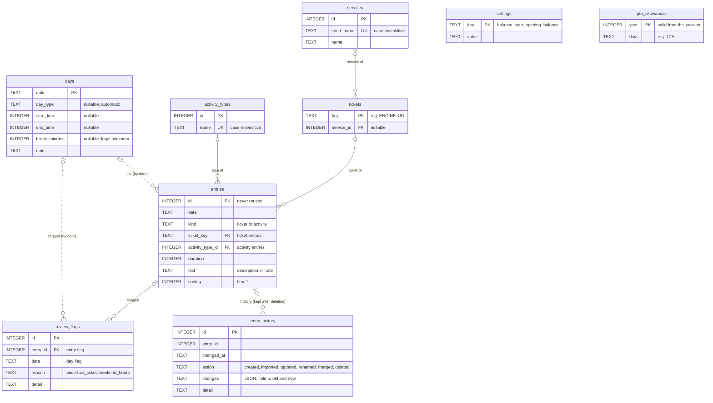

# work-tracker

Simple tracker for daily tasks: working hours, overtime balance, PTO and task entries for the
monthly work report. A Falcon REST API with a small browser frontend, backed by SQLite, run locally.

The project was partially implemented using claude.ai.

> Work in progress — calculation rules, storage and spreadsheet import are done; API and frontend follow.

## Requirements

- Python 3.15
- [Pipenv](https://pipenv.pypa.io/)

## Setup

```shell
pipenv install --dev
```

## Import the spreadsheet

One CSV export per year; the database is `$WORK_TRACKER_DB`, or `work_tracker.db` in the working directory.

```shell
pipenv run python -m src.modules.importer "examples/Time_tracking_DK - 2024_Data.csv"
pipenv run python -m src.modules.importer "examples/Time_tracking_DK - 2024_Data.csv" --replace  # import a year again
```

A year is imported in one transaction: on any error nothing is written. `--replace` deletes the year's days,
entries, history and flags first; tickets keep their assigned services.

## Tests and code quality

```shell
pipenv run pytest
pipenv run flake8 --count --exit-zero --radon-max-cc 6 --radon-no-assert --max-line-length=127 \
  --statistics --exclude=.idea,.venv,test,.terraform --extend-ignore=E203,W503,ANN101,ANN102
```

## Project layout

| Path                   | Contents                                                               |
|------------------------|------------------------------------------------------------------------|
| `src/lib`              | Calculation rules: durations, breaks, holidays, targets, overtime, PTO |
| `src/models`           | Pydantic models                                                        |
| `src/modules`          | Features: storage, import, days, entries, reports, review              |
| `src/utils`            | Shared helpers                                                         |
| `src/defaultresources` | Default resource                                                       |
| `src/templates`        | Frontend pages (TypeScript)                                            |
| `src/tests`            | Tests, mirroring the packages above                                    |

## Calculation rules (`src/lib`)

All times and durations are whole minutes.

| Module            | Rules                                                                                                                                                                                        |
|-------------------|----------------------------------------------------------------------------------------------------------------------------------------------------------------------------------------------|
| `durations`       | Parse and format clock times (`HH:MM`), durations (`h:mm`) and decimal-comma hours (`1,5`); split durations evenly in quarter hours                                                          |
| `worktime`        | Worked time = end − start − break; without a break, the legal minimum applies (German ArbZG §4: 0:30 beyond 6 h, 0:45 beyond 9 h)                                                            |
| `public_holidays` | Berlin public holidays (via `holidays`), plus Heiligabend and Silvester as company half days                                                                                                 |
| `daytypes`        | Day types (see below) with target time and PTO used; weekends have no target. Overtime = worked − target                                                                                     |
| `balances`        | Overtime balance over every calendar day up to a cut-off date (a weekday without record counts as −8:00); PTO per year (used, planned, remaining), carrying the remainder into the next year |
| `dates`           | Date range helper                                                                                                                                                                            |

### Day types

Targets and PTO apply Mon–Fri; on weekends every type has target 0:00 and uses no PTO.

| Type               | Description                                              | Target | PTO |
|--------------------|----------------------------------------------------------|--------|-----|
| `work`             | Regular work day (default)                               | 8:00   | 0   |
| `pto`              | Paid time off, full day                                  | 0:00   | 1   |
| `pto_half`         | Paid time off, half day                                  | 4:00   | 0.5 |
| `sick`             | Off sick, full day                                       | 0:00   | 0   |
| `sick_half`        | Off sick, half day                                       | 4:00   | 0   |
| `overtime_off`     | Day off taken from the overtime balance                  | 8:00   | 0   |
| `unpaid_leave`     | Unpaid day off                                           | 0:00   | 0   |
| `public_holiday`   | Berlin public holiday (automatic)                        | 0:00   | 0   |
| `company_half_day` | Heiligabend / Silvester: half PTO, half free (automatic) | 0:00   | 0.5 |

## Domain models (`src/models`)

Pydantic models; times in minutes, validated on creation and assignment.

| Module     | Models                                                                                                                                  |
|------------|-----------------------------------------------------------------------------------------------------------------------------------------|
| `days`     | `Day`: date, day type (empty = automatic), start / end, break (empty = legal minimum), note; provides worked time                       |
| `entries`  | `TicketEntry` (ticket, duration, description, coding) and `ActivityEntry` (activity type, duration, note); durations in quarter hours   |
| `catalog`  | `Service`, `ActivityType` and `Ticket` (key like `ENGINE-461`, remembers its service)                                                   |
| `history`  | `EntryChange`: one line of an entry's history (created, imported, updated, renamed, merged, deleted) with the changed fields, old → new |
| `review`   | `ReviewFlag`: import flag on an entry or a day (uncertain ticket, weekend hours)                                                        |
| `settings` | `Settings`: balance start date, opening balance, PTO allowance per year (valid from that year on)                                       |

## Storage (`src/modules/storage`)

SQLite, one connection per transaction (commit on success, rollback on error), foreign keys enforced.
Repositories work within the transaction of the connection they are given.

| Module       | Contents                                                                                                                                                                        |
|--------------|---------------------------------------------------------------------------------------------------------------------------------------------------------------------------------|
| `database`   | `Database(path)`: transactions and schema migration (`migrate()`, tracked in `PRAGMA user_version`)                                                                             |
| `migrations` | Schema scripts, applied once in order; the first one seeds settings, services and activity types. Entries keep a change history that outlives them (entry ids are never reused) |
| `settings`   | Load and save user settings                                                                                                                                                     |
| `days`       | `DayRepository`: get, list, save (insert or replace) and delete days; records for balances; review flags on days                                                                |
| `catalog`    | `ServiceRepository`, `ActivityTypeRepository`: list, get, add, update, delete (deleting a service unassigns its tickets; an activity type in use cannot be deleted)             |
| `tickets`    | `TicketRepository`: get, list (sorted by prefix and number), create on first use; set a service on one or several tickets; tickets without service                              |
| `entries`    | `EntryRepository`: get, list, create, update and delete entries, each change written to the entry's history (kept after deletion); review flags on entries                      |
| `renames`    | `rename_ticket`: move all entries to a new key (history line per entry); renaming to an existing ticket merges both, the existing ticket keeps its service                      |
| `errors`     | `NotFoundError` for records that do not exist, `ConflictError` for duplicates and records still in use                                                                          |

### Database schema

Solid lines are foreign keys; dotted lines are links without one (by date, or kept after deletion).
Times and durations are minutes, dates ISO text.



## Import (`src/modules/importer`)

Imports the yearly spreadsheet exports (CSV with `Date`, `Start`, `End`, `Pause`, `Sum`, `Comment`).

| Module        | Contents                                                                                                                                                                                                |
|---------------|---------------------------------------------------------------------------------------------------------------------------------------------------------------------------------------------------------|
| `sheet`       | Read a CSV into one `SheetRow` per day: date (weekday checked), times, pause, sum and comment lines; detects empty future days and placeholder times (08:00–16:00 without break)                        |
| `lines`       | Split leading decimal-comma hours off a comment line (`1,5 KP-2035 refinement` → 1:30)                                                                                                                  |
| `days`        | Day type (PTO, sick, half days, overtime off; holidays automatic), times (placeholders dropped, half days end 4:00 earlier, weekends `Sum` − 8:00), notes for overtime used, weekend flags              |
| `tickets`     | Ticket keys (KP, TNG, ENGINE, AGA, MSI) and their clean-up: typos corrected (`EINGINE-`, `TNG4840`, `MSI-02`, `#KP-1494`); guessed keys flagged (`#4138` → `TNG-4138`, `#4347 aka #1482`, `TNG-2035ff`) |
| `comments`    | Comment lines → entries: tickets anywhere in a line (several tickets split evenly), PR reviews without ticket, Meeting, Tool Management, Travel, Other; lines without hours or ticket become day notes  |
| `corrections` | Known corrections the sheet cannot express: 2024 unpaid leave days (marked "PTO")                                                                                                                       |
| `run`         | Import one year in a single transaction: days, entries (history line with the original comment line), review flags; refuses years with data unless replacing; summary                                   |
| `__main__`    | Command line: `python -m src.modules.importer SHEET.csv [--replace] [--db PATH]`                                                                                                                        |
